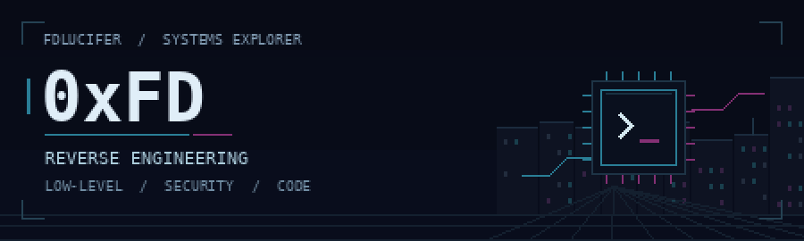

<picture>
  <source media="(prefers-reduced-motion: reduce)" srcset="./assets/neon-header.png">
  
</picture>

[Static banner](./assets/neon-header.png)

### Hi Bros, nice to meet you, let's coding with fun and precision...👋

<!--
**FDlucifer/FDlucifer** is a ✨ _special_ ✨ repository because its `README.md` (this file) appears on your GitHub profile.

Here are some ideas to get you started:

- 🔭 I’m currently working on ...
- 🌱 I’m currently learning ...
- 👯 I’m looking to collaborate on ...
- 🤔 I’m looking for help with ...
- 💬 Ask me about ...
- 📫 How to reach me: ...
- 😄 Pronouns: ...
- ⚡ Fun fact: ...
-->

- 🔭 Now focusing on win/lin/mac os kernel sec & low level langudage & algorithms ...
- 🌱 Now skilling with python & golang & java & arm & x86 & c ...
- ⚡ Fun interest: playing switch and old pixel games ...
- 🤔 special skills:

- 1. 0-day reasearch
- 2. low level things
- 3. now focus on pwn && reversing will dig into the deepest
- 4. also like to play codewars && leetcode && adventure of code && codeforce challenges
- 5. 1000000000000% CTF addict
- 6. hackthebox guru expert also play tryhackme and other ctf online platforms
- 7. my goal is control every bytes of a hardware, like a goast in the computer [鬼上电脑] :>>>>>

---

## `01` // CURRENT SIGNAL

**Reverse engineer. Systems tinkerer. Pixel-game fan.**

I like working from the bytes up: start with a binary or a trace, follow what the machine is actually doing, and turn the interesting parts into notes or small tools. My workbench spans **Windows, Linux, and macOS**, with **ARM and x86** on the architecture side and **Python, Go, and C** for experiments.

- **Systems & binaries:** kernel internals, memory behavior, disassembly, and debugging.
- **Security research:** binary analysis and CTFs, with an interest in writing down what a trace proves and what it doesn't.
- **Exploring next:** Ethereum execution and blockchain development, from bytecode and transaction traces to contract testing.
- **Off the bench:** retro pixel games and neon-lit cyberpunk worlds.

## `02` // SELECTED WORK & LEARNING ARCHIVES

- **[Technical blog](https://github.com/FDlucifer/FDlucifer.github.io)** · Notes on reverse engineering, binary security, and CTF write-ups.
- **[goendecoder](https://github.com/FDlucifer/goendecoder)** · Go experiments in encoding, decoding, and CTF-oriented cryptography.
- **[Python / C / C++ practice](https://github.com/FDlucifer/python-climb-learning-tutorial)** · Learning exercises, including practice based on NeuralNine tutorials.
- **[Algorithm notebook](https://github.com/FDlucifer/python300-arithmetic)** · Python algorithm exercises collected for practice and review.

0xFD // LOW-LEVEL SYSTEMS · REVERSE ENGINEERING · PIXEL ART
